# Library Management System (LMS)
## Faculty Presentation, Architecture & Viva Demonstration Guide

**Candidate:** Daksh Dua  
**Roll Number:** 25MCMC21  
**Degree / Program:** Master of Computer Applications (MCA)  
**Institution:** University of Hyderabad (SCIS)  
**Repository:** [https://github.com/dakshdua03/Library-Management-System](https://github.com/dakshdua03/Library-Management-System)  
**Technology Stack:** Python 3, Flask, SQLite, SQLAlchemy ORM, Bootstrap 5, Jinja2, PlantUML  

---

## Table of Contents
1. [Project Overview & Architecture Mapping](#1-project-overview--architecture-mapping)
2. [Part 1: Architectural & Design Diagrams (Sorted PNG Gallery)](#2-part-1-architectural--design-diagrams-sorted-png-gallery)
   - [01. Architectural Patterns (Sommerville)](#01-architectural-patterns-sommerville)
   - [02. Communication Diagrams](#02-communication-diagrams)
   - [03. Sequence Diagrams](#03-sequence-diagrams)
   - [04. Domain Class Diagram](#04-domain-class-diagram)
   - [05. Analysis & Design (DFD, Transform Analysis, Structure Chart)](#05-analysis--design-dfd-transform-analysis-structure-chart)
3. [Part 2: The Project — Sprints, Features & Local Execution](#3-part-2-the-project--sprints-features--local-execution)
   - [Local Installation & Startup](#local-installation--startup)
   - [Demo User Accounts](#demo-user-accounts)
   - [Sprint 1: Patron Management & ISBN Cataloging](#sprint-1-patron-management--isbn-cataloging)
   - [Sprint 2: Circulation Desk, 5-Point Validation & Auto Fines](#sprint-2-circulation-desk-5-point-validation--auto-fines)
   - [Sprint 3: Student Self-Service Catalog & FCFS Reservations](#sprint-3-student-self-service-catalog--fcfs-reservations)
   - [Sprint 4: Bulk CSV Onboarding, Pipe-Filter Notification Engine & Analytics](#sprint-4-bulk-csv-onboarding-pipe-filter-notification-engine--analytics)
4. [Part 3: Acceptance Tests & Demonstration Guide](#4-part-3-acceptance-tests--demonstration-guide)
   - [Automated Test Suite (32/32 Passing)](#automated-test-suite-3232-passing)
   - [Interactive Web Test Runner (/qa)](#interactive-web-test-runner-qa)
   - [Step-by-Step Live Faculty Demonstration Script](#step-by-step-live-faculty-demonstration-script)

---

## 1. Project Overview & Architecture Mapping

This Library Management System was implemented adhering strictly to **Ian Sommerville's Software Engineering Architecture Patterns** and the exact sprint acceptance criteria defined in the *Product and Sprint Backlog*.

The system enforces session-based role-based access control (Admin, Librarian, Student, Faculty), modular service-oriented architecture, automated 5-point circulation validations, automated fine calculation (₹2.00/day capped at ₹200.00), a First-Come-First-Served (FCFS) reservation queue with hold-matching, and a Somerville-style Pipe-and-Filter notification engine.

---

## 2. Part 1: Architectural & Design Diagrams (Sorted PNG Gallery)

All 25 project diagrams have been reviewed, verified against the Sommerville standard, and organized into categorized subfolders under `diagrams/`:

```
diagrams/
├── 01_Architectural_Patterns/   # Sommerville 6 standard architectural patterns
├── 02_Communication_Diagrams/   # UML Communication Diagrams for core transactions
├── 03_Sequence_Diagrams/        # Detailed Sequence Diagrams for circulation & cataloging
├── 04_Class_Diagrams/           # Domain object class diagram
└── 05_Analysis_And_Design/      # DFD, Transform Analysis & Software Structure Chart
```

### 01. Architectural Patterns (Sommerville)

These diagrams visualize how different architectural styles apply to the Library Management System:

1. **Model-View-Controller (MVC) Pattern**  
   *File:* `diagrams/01_Architectural_Patterns/LMS_Arch_01_MVC.png`  
   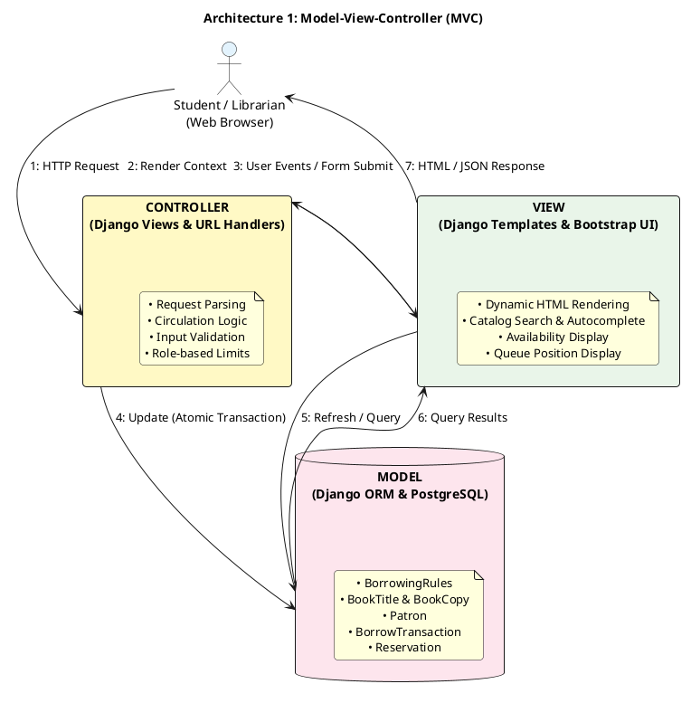  
   - **Controller:** Flask Blueprints (`auth_bp`, `circulation_bp`, `catalog_bp`, `selfservice_bp`, `reports_bp`).
   - **Model:** SQLAlchemy domain models (`Patron`, `BookTitle`, `BookCopy`, `BorrowTransaction`, `Reservation`, `FineRecord`).
   - **View:** Jinja2 Bootstrap 5 templates with dynamic async autocomplete and status cards.

2. **Layered Architecture (LIBSYS Reference Model)**  
   *File:* `diagrams/01_Architectural_Patterns/LMS_Arch_02_Layered_LIBSYS.png`  
   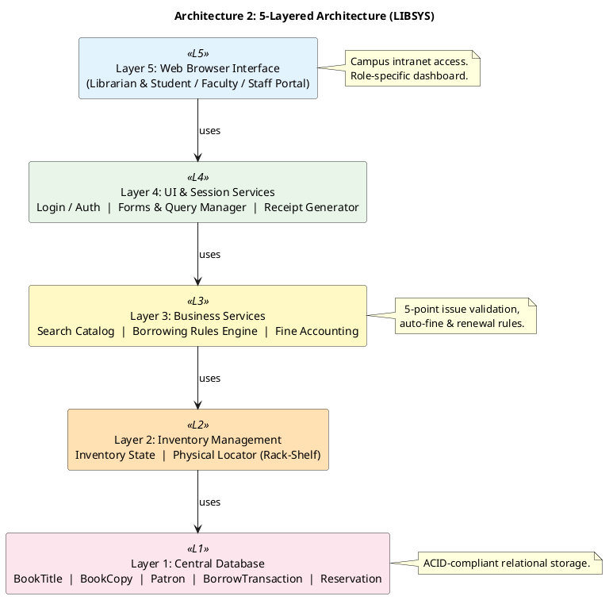  
   - 4-Tier layering: User Interface $\rightarrow$ User Interaction & Authentication $\rightarrow$ Library Business Logic Services $\rightarrow$ SQLite Storage & External APIs (OpenLibrary / Google Books).

3. **Repository Architecture**  
   *File:* `diagrams/01_Architectural_Patterns/LMS_Arch_03_Repository.png`  
   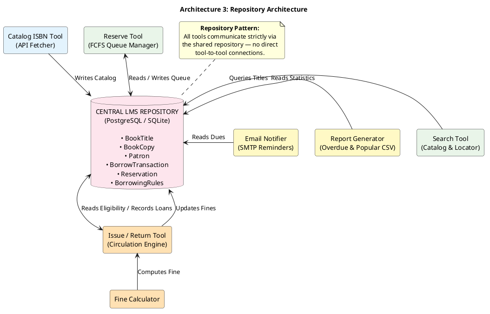  
   - Central SQLite repository shared between independent sub-systems: Circulation Desk, Self-Service Catalog, Waitlist Engine, and Notification Services.

4. **Client-Server Architecture**  
   *File:* `diagrams/01_Architectural_Patterns/LMS_Arch_04_Client_Server.png`  
   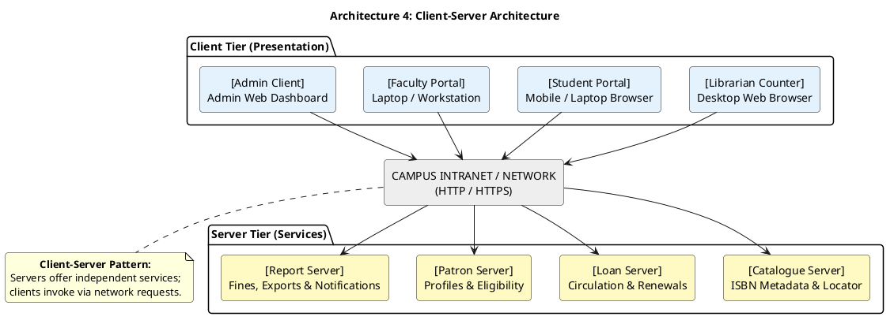  
   - Web browser clients communicating over HTTP/HTTPS with the Flask application server and SQLite transactional backend.

5. **Pipe-and-Filter Architecture (Batch Notification Processing)**  
   *File:* `diagrams/01_Architectural_Patterns/LMS_Arch_05_Pipe_Filter.png`  
   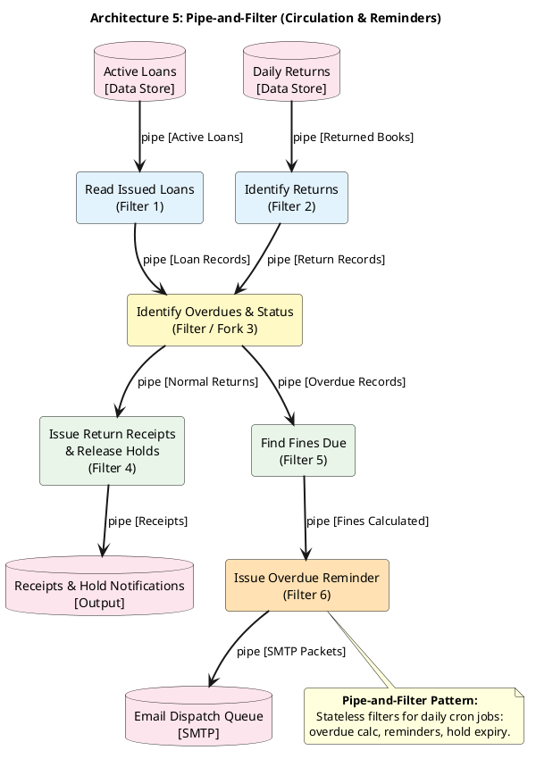  
   - Implemented in `NotificationService`: Active Loan Collector $\rightarrow$ Due-Date Filter (T-1, Due Today, Overdue) $\rightarrow$ Daily 1-Message De-duplication $\rightarrow$ Notification Dispatcher / Audit Logger.

6. **Detailed Layered Architecture (MHCPMS Standard)**  
   *File:* `diagrams/01_Architectural_Patterns/LMS_Arch_06_Detailed_Layered_MHCPMS.png`  
   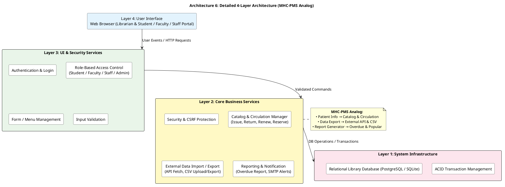  
   - Enterprise multi-tier breakdown separating HTTP routing, security decorators (`@login_required`, `@role_required`), domain services, and ORM persistence.

---

### 02. Communication Diagrams

UML Communication diagrams showing collaborating objects and message sequencing for key transactions:

1. **Issue Book:** `diagrams/02_Communication_Diagrams/LMS_CD_01_Issue_Book.png`  
   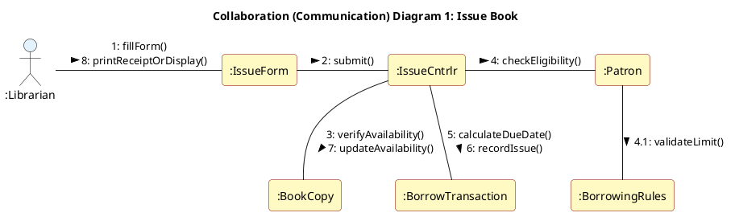  
2. **Return Book:** `diagrams/02_Communication_Diagrams/LMS_CD_02_Return_Book.png`  
   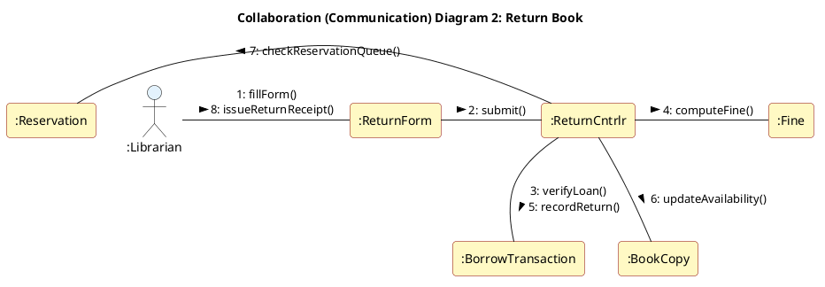  
3. **Renew Book:** `diagrams/02_Communication_Diagrams/LMS_CD_03_Renew_Book.png`  
   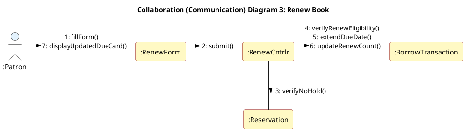  
4. **Reserve Book:** `diagrams/02_Communication_Diagrams/LMS_CD_04_Reserve_Book.png`  
   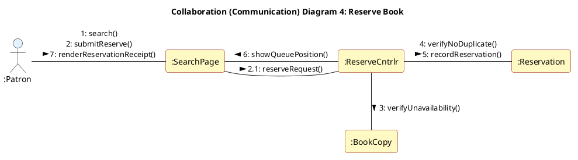  
5. **Add Book via ISBN:** `diagrams/02_Communication_Diagrams/LMS_CD_05_Add_Book_ISBN.png`  
   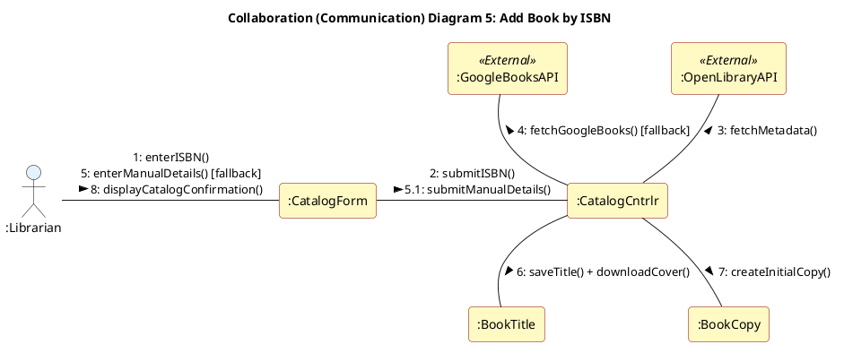  

---

### 03. Sequence Diagrams

Temporal interaction sequences illustrating synchronous validations, database state changes, and feedback cards:

1. **Detailed Issue Book Sequence (5 Guards Enforced):** `diagrams/03_Sequence_Diagrams/LMS_SD_01_Issue_Book.png`  
   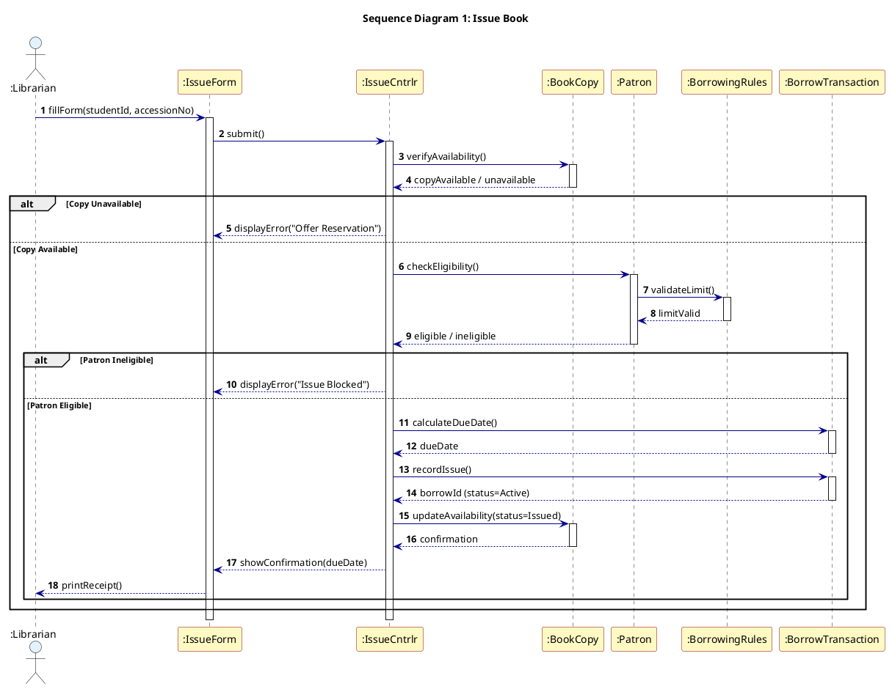  
2. **Detailed Return Book Sequence (Automated Fine Engine):** `diagrams/03_Sequence_Diagrams/LMS_SD_02_Return_Book.png`  
   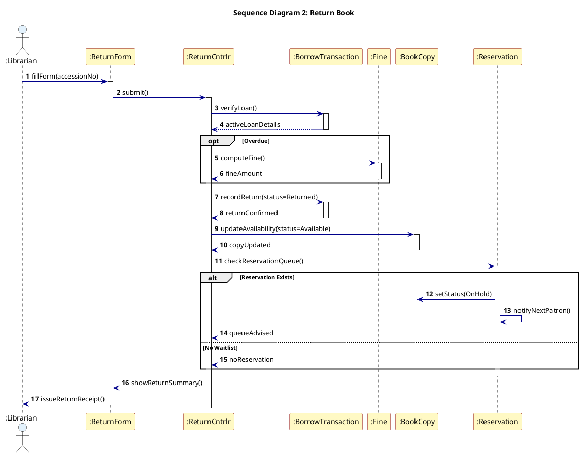  
3. **Detailed Renewal Sequence (Overdue & Reservation Checks):** `diagrams/03_Sequence_Diagrams/LMS_SD_03_Renew_Book.png`  
   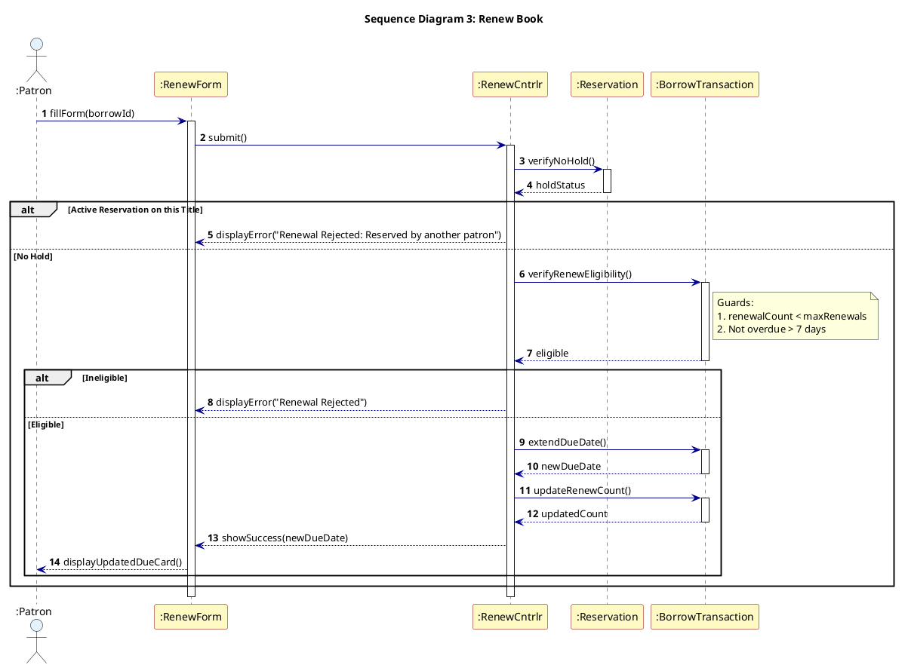  
4. **Detailed Reservation Sequence (FCFS Queue Logic):** `diagrams/03_Sequence_Diagrams/LMS_SD_04_Reserve_Book.png`  
   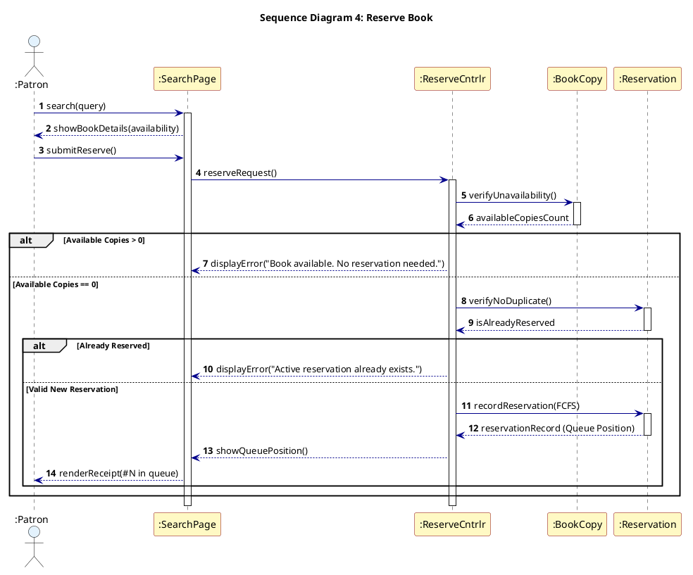  
5. **Detailed Add Book via ISBN Sequence (Dual API Fallback):** `diagrams/03_Sequence_Diagrams/LMS_SD_05_Add_Book_ISBN.png`  
   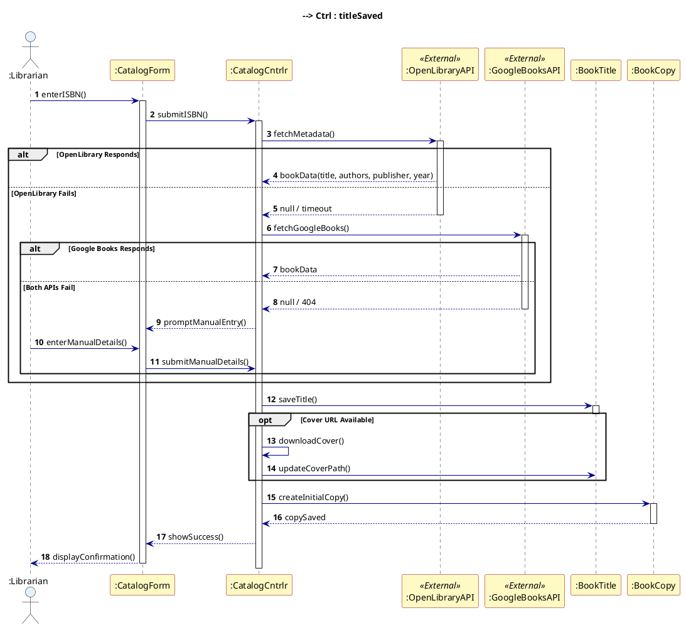  

*Additional core interaction sequences included:*  
- `LMS_Issue_Sequence.png`, `LMS_Return_Sequence.png`, `LMS_Sequence_Issue.png`, `LMS_Sequence_Renew.png`, `LMS_Sequence_Return.png`.

---

### 04. Domain Class Diagram

*File:* `diagrams/04_Class_Diagrams/LMS_Class_Refined.png`  
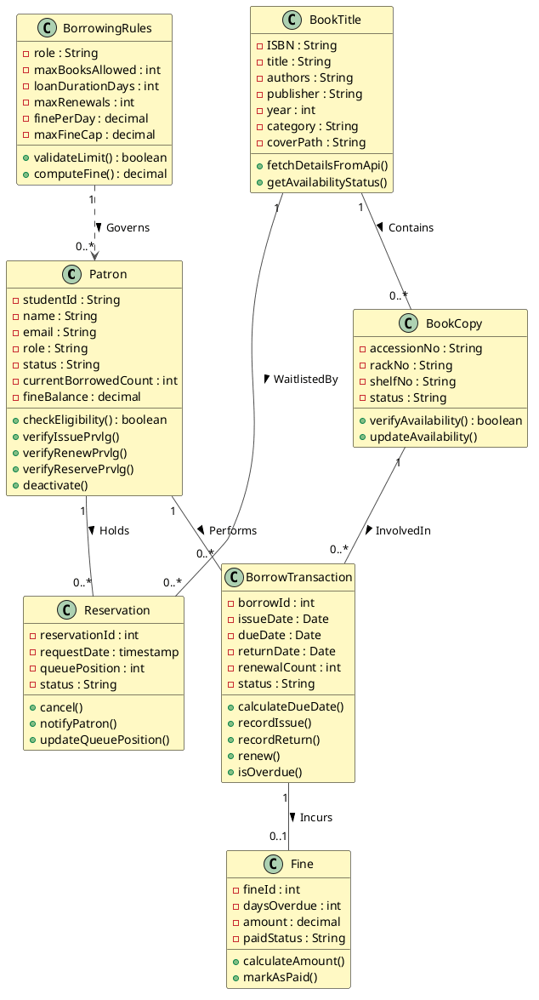  

Represents the complete database schema implemented in `app/models.py`:
- `Patron` (Attributes: id, roll_number, name, email, role, department, fine_balance, current_borrowed_count, is_active, photo_path).
- `BorrowingRules` (Attributes: role, max_books, loan_period_days, max_renewals, fine_per_day).
- `BookTitle` (Attributes: isbn, title, authors, publisher, year, category, cover_path).
- `BookCopy` (Attributes: accession_no, isbn, status, rack_no, shelf_no).
- `BorrowTransaction` (Attributes: id, patron_id, accession_no, issue_date, due_date, return_date, renewal_count, fine_amount, status).
- `Reservation` (Attributes: id, patron_id, isbn, request_date, queue_position, status, hold_expiry_date).
- `FineRecord` (Attributes: id, borrow_id, patron_id, fine_date, days_overdue, amount, is_paid).

---

### 05. Analysis & Design (DFD, Transform Analysis, Structure Chart)

These diagrams trace requirements decomposition from structured data flow to modular software design:

1. **Transaction-Centered Data Flow Diagram (DFD):**  
   *File:* `diagrams/05_Analysis_And_Design/LMS_Transaction_DFD.png`  
   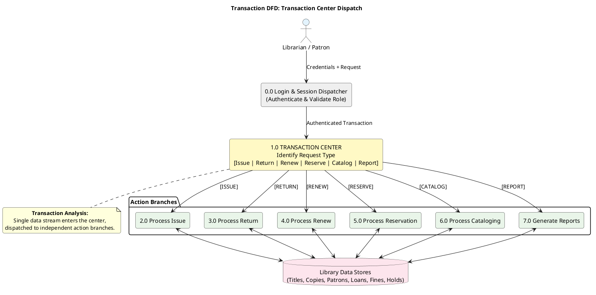  
   - Delineates action dispatching across Issue, Return, Renew, Reserve, and Cataloging transaction streams.

2. **Transform Analysis (Flow In-Out Mapping):**  
   *File:* `diagrams/05_Analysis_And_Design/LMS_Transform_Analysis.png`  
   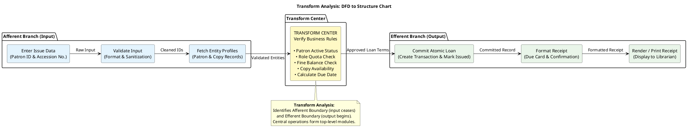  
   - Maps Afferent Branch (Input verification) $\rightarrow$ Central Transform (Fine calculation, Queue reordering, Inventory adjustment) $\rightarrow$ Efferent Branch (Feedback receipt & CSV generation).

3. **Software Structure Chart:**  
   *File:* `diagrams/05_Analysis_And_Design/LMS_Structure_Chart.png`  
   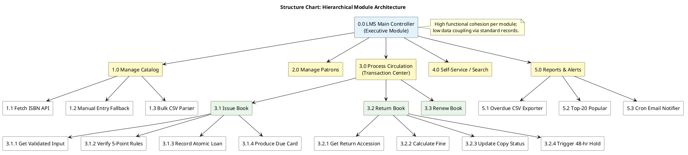  
   - Top-down functional hierarchy of the complete system from `Library_Management_System_Root` to worker modules.

---

## 3. Part 2: The Project — Sprints, Features & Local Execution

### Local Installation & Startup

To run the application locally on any Linux, macOS, or Windows terminal:

```bash
# 1. Navigate to the Implementation directory
cd Implementation

# 2. Create and activate a Python virtual environment
python3 -m venv venv
source venv/bin/activate      # On Windows: venv\Scripts\activate

# 3. Install dependencies
pip install -r requirements.txt

# 4. Start the application server
python3 run.py
```

The application will start at: **`http://127.0.0.1:5000`**

*(Note: On first startup, `run.py` automatically initializes `lms.db` and loads the rich university dataset with textbooks, patrons, active loans, overdue fines, and waitlists).*

---

### Demo User Accounts

Switch roles using the 1-click quick login buttons on the login page (`/auth/login`) or type Roll Numbers:

| Role | Roll Number / ID | Name | Department | Notes |
|---|---|---|---|---|
| **Admin** | `ADMIN01` | System Administrator | Library Administration | Full access to borrowing rules, cataloging, patrons, bulk CSV & reports |
| **Librarian** | `LIB01` | Chief Librarian | Central Library | Access to circulation desk (Issue, Return, Active Loans) & waitlist monitors |
| **Student** | `25MCMC21` | **Daksh Dua** | SCIS - MCA | Sole Project Author. Has active loans and reservation queue position |
| **Student** | `25PHPH08` | Rohan Verma | School of Physics | Demo account with an overdue loan and unpaid ₹12.00 fine |
| **Faculty** | `FAC01` | Dr. Alok Singh | SCIS - Faculty | 10-book quota, 30-day loan period |

---

### Sprint 1: Patron Management & ISBN Cataloging
- **Patron Management (`/patrons/`):**
  - Unique constraint validation on Roll Number and Email.
  - Active/Deactivated account status toggling.
  - Patron portrait photo upload with local media storage.
- **Dynamic Borrowing Rules Editor (`/patrons/rules`):**
  - Configurable parameters per role (Student, Faculty, Research Scholar): Maximum allowed books, loan duration (days), maximum renewal count, and fine rate per day.
- **Smart ISBN Cataloging Engine (`/catalog/add-by-isbn`):**
  - Enter any 10- or 13-digit ISBN $\rightarrow$ Automatically queries OpenLibrary API, falling back to Google Books API.
  - Downloads high-resolution cover image locally for offline serving.
  - Offline Manual Fallback Entry form (`/catalog/manual-add`) when no network is available.

---

### Sprint 2: Circulation Desk, 5-Point Validation & Auto Fines
- **Issue Counter (`/circulation/issue`):**
  - **Autocomplete:** Live search for Patrons (by roll/name/email) and Book Copies (by accession, title, author, or ISBN).
  - **Enforced 5-Point Validation Guards:**
    1. Patron account must be Active (blocked if deactivated).
    2. Overdue fine balance must be $\le$ ₹100.00 (blocked if fine exceeds limit).
    3. Current borrowed books must not exceed Role quota (e.g. 3 books for Student).
    4. Copy status must be `Available` on shelf.
    5. Duplicate Title Guard: Patron cannot borrow two copies of the same book title simultaneously.
  - **1-Click Issue Confirmation Card (`/circulation/issue/confirm/<id>`):** Displays patron photo, book title, accession number, and auto-computed due date.
- **Return Counter (`/circulation/return`):**
  - Enter Accession Number or Transaction ID $\rightarrow$ Restores copy status to `Available`.
  - **Automated Fine Engine:** ₹2.00 per overdue day (capped at ₹200.00 maximum per loan). Renders instant return summary receipt.
- **Renewal System (`/circulation/renew/<id>`):**
  - Guards: Cannot renew if overdue by $>7$ days, cannot exceed maximum renewal quota (e.g. 2 times), and cannot renew if another student holds an active waitlist reservation.
- **Active Loans Directory (`/circulation/`):** Real-time list of all borrowed books with color-coded overdue warnings.

---

### Sprint 3: Student Self-Service Catalog & FCFS Reservations
- **Responsive Public Catalog Search (`/selfservice/search`):**
  - Live search by title, author, category, or ISBN with autocomplete suggestions.
  - Filter by category and toggle *"Show Available Books Only"*.
  - Displays cover image, rack and shelf location, and copy status (e.g. `2/3 Available on Shelf`).
- **Book Details & Physical Availability (`/selfservice/book/<isbn>`):**
  - Detailed metadata, shelf locations for all physical copies, and current waitlist queue length.
- **First-Come-First-Served (FCFS) Reservation Queue Engine (`ReservationService`):**
  - When all copies of a title are checked out (0 available), students can place a reservation.
  - Strict chronological FCFS queue ordering (#1, #2, ...).
  - Duplicate reservation guard: A student cannot reserve the same title twice while holding a pending hold.
  - **Hold Allocation on Return:** When an issued copy is returned, the engine automatically assigns the book to Queue Position #1 and grants a 48-hour hold window.
  - **Queue Re-balancing on Cancellation:** Canceling a hold automatically shifts subsequent patrons up by 1 rank.
- **Waitlist Monitors:**
  - Student: *My Reservations* (`/selfservice/my-reservations`) showing active holds, queue ranks, and hold status.
  - Librarian/Admin: *Reservation Waitlists Monitor* (`/selfservice/admin-queue`) tracking queues library-wide.

---

### Sprint 4: Bulk CSV Onboarding, Pipe-Filter Notification Engine & Analytics
- **Bulk CSV Book Onboarding (`/catalog/bulk-csv`):**
  - Batch upload hundreds of book titles and copies via CSV.
  - **Row-by-Row Error Validation:** Detailed table reporting valid rows added versus invalid rows skipped (duplicate ISBN/accession numbers, missing fields). Sample template download included.
- **Sommerville Pipe-and-Filter Automated Notification Engine (`NotificationService`):**
  - **Filter 1 (Collector):** Retrieves active borrow records and pending holds.
  - **Filter 2 (Categorizer):** Evaluates dates:
    - Upcoming Due Date Reminder (T-1 day).
    - Due Date Today Reminder.
    - Daily Overdue Alert with accrued fine notice.
    - 48-Hour Hold Expiration for reserved books.
  - **Filter 3 (De-duplication Guard):** Ensures at most 1 reminder per day per patron per book.
  - **Filter 4 (Dispatch & Audit Logger):** Logs notifications to `NotificationAudit` and renders audit table at `/reports/notifications`.
- **Administrative Reports & Analytics:**
  - **Overdue Books Report (`/reports/overdue`):** Filter by department, role, or days overdue. 1-click **Export Overdue CSV** button for official circulation audits.
  - **Popular Books Ranking (`/reports/popular`):** Top-20 most circulated books sorted by checkout frequency with total copies and lifetime checkout counts.

---

## 4. Part 3: Acceptance Tests & Demonstration Guide

### Automated Test Suite (32/32 Passing)

The project includes an automated test suite with **32 unit and acceptance tests** verifying all sprint backlog requirements:

```
tests/
├── test_sprint1.py   # 8 Tests: Patron uniqueness, borrowing rules, ISBN fetcher, manual add
├── test_sprint2.py   # 11 Tests: 5-point issue validations, auto due dates, fine calc, renewals
├── test_sprint3.py   # 6 Tests: Public search, FCFS waitlist queue, return-hold assignment, cancellation
└── test_sprint4.py   # 7 Tests: Bulk CSV onboarding, pipe-and-filter notification pipeline, report queries
```

#### How to Run the Tests via Terminal:

```bash
cd Implementation
source venv/bin/activate
python3 -m unittest -v discover tests
```

#### Acceptance Test Traceability Matrix:

| Test ID | Test Method | Sprint Backlog Requirement Verified | Status |
|---|---|---|---|
| **S1-01** | `test_patron_creation_and_uniqueness` | Unique roll number and email validations | **PASS** |
| **S1-02** | `test_borrowing_rules_defaults` | Default borrowing limits for Student, Faculty, Scholar | **PASS** |
| **S1-03** | `test_admin_can_update_borrowing_rules` | Dynamic rule modification via admin panel | **PASS** |
| **S1-04** | `test_clean_isbn_utility` | ISBN normalization (hyphens and whitespace removal) | **PASS** |
| **S1-05** | `test_isbn_mock_fetch_metadata` | Dual API metadata fetching and field mapping | **PASS** |
| **S1-06** | `test_book_title_and_copy_relationship` | One-to-many relationship between BookTitle and BookCopy | **PASS** |
| **S1-07** | `test_manual_add_title_and_copy` | Offline manual fallback book cataloging | **PASS** |
| **S1-08** | `test_patron_active_toggle` | Admin toggle for patron account deactivation | **PASS** |
| **S2-01** | `test_successful_book_issue` | Standard book issue with automatic due date computation | **PASS** |
| **S2-02** | `test_issue_blocked_when_patron_deactivated` | Guard 1: Deactivated patron blocked from borrowing | **PASS** |
| **S2-03** | `test_issue_blocked_when_fine_exceeds_threshold` | Guard 2: Patron with fine > ₹100 blocked from borrowing | **PASS** |
| **S2-04** | `test_issue_blocked_when_max_books_quota_reached` | Guard 3: Patron reaching role limit blocked from borrowing | **PASS** |
| **S2-05** | `test_issue_blocked_when_copy_not_available` | Guard 4: Copy with status != 'Available' blocked | **PASS** |
| **S2-06** | `test_issue_blocked_when_duplicate_title` | Guard 5: Simultaneous borrowing of same title blocked | **PASS** |
| **S2-07** | `test_on_time_return_no_fine` | On-time return clears loan with ₹0 fine and restores copy | **PASS** |
| **S2-08** | `test_overdue_return_with_fine_calculation` | Overdue return applies ₹2/day fine and updates patron balance | **PASS** |
| **S2-09** | `test_fine_capped_at_maximum_limit` | Maximum fine ceiling of ₹200.00 strictly enforced | **PASS** |
| **S2-10** | `test_successful_renewal` | Valid renewal extends due date and increments count | **PASS** |
| **S2-11** | `test_renewal_blocked_when_overdue_cutoff_exceeded` | Renewal blocked when book is overdue by $>7$ days | **PASS** |
| **S3-01** | `test_public_catalog_search` | Keyword filtering by title, author, and category | **PASS** |
| **S3-02** | `test_available_books_filter` | Filter toggle hides titles with 0 available copies | **PASS** |
| **S3-03** | `test_reservation_queue_order` | FCFS queue ranks assigned chronologically (#1, #2) | **PASS** |
| **S3-04** | `test_duplicate_reservation_blocked` | Patron cannot place duplicate holds on the same title | **PASS** |
| **S3-05** | `test_return_triggers_reservation_hold` | Returning a book assigns hold to top waiting patron | **PASS** |
| **S3-06** | `test_cancel_reservation_rebalances_queue` | Canceling hold re-indexes remaining patrons' positions | **PASS** |
| **S4-01** | `test_bulk_csv_valid_import` | Bulk CSV parser successfully catalogs books and copies | **PASS** |
| **S4-02** | `test_bulk_csv_row_error_reporting` | Duplicate and malformed CSV rows reported per line | **PASS** |
| **S4-03** | `test_notification_due_date_alerts` | Automated pipeline detects T-1 and due-today loans | **PASS** |
| **S4-04** | `test_notification_daily_deduplication` | At most 1 reminder per day per patron per book dispatched | **PASS** |
| **S4-05** | `test_hold_expiration_and_queue_advancement` | Expired 48h holds cancelled and offered to next in queue | **PASS** |
| **S4-06** | `test_overdue_report_query` | Overdue report accurately aggregates delinquent patrons | **PASS** |
| **S4-07** | `test_popular_books_ranking` | Popular books report correctly ranks highest checked-out titles | **PASS** |

---

### Interactive Web Test Runner (/qa)

In addition to running unit tests from the command line, an interactive test dashboard is built into the web application:

1. Open your browser to **`http://127.0.0.1:5000/qa`** (or click **"Acceptance Tests"** on the navigation bar).
2. Click **"Run All 32 Acceptance Tests"**.
3. The server executes all four test suites in real-time, displaying live pass counters, execution duration, and green status badges for each test class.

---

### Step-by-Step Live Faculty Demonstration Script

Follow this script during your viva presentation to demonstrate all system capabilities sequentially:

#### 1. Show the Architecture & Design Foundation
- Open the `diagrams/` folder and present `LMS_Arch_01_MVC.png` and `LMS_Arch_02_Layered_LIBSYS.png`.
- Explain how Flask Blueprints match the Controller tier, SQLAlchemy matches the Model tier, and Jinja2 templates form the View tier.
- Present `LMS_SD_01_Issue_Book.png` to show the 5 validation guards before opening the live app.

#### 2. Demonstrate Sprint 1 (Patron Rules & Smart ISBN Cataloging)
1. Log in as **Admin** (`ADMIN01`).
2. Go to **Patron Management $\rightarrow$ Borrowing Rules**:
   - Show how the Student loan limit is currently set to 3 books and ₹2.00/day fine.
   - Edit the rule (e.g. change quota to 4 books) and save. Show the success message.
3. Go to **Patron Management $\rightarrow$ Add Patron**:
   - Try typing Roll Number `25MCMC21` $\rightarrow$ Submit $\rightarrow$ Show the validation error preventing duplicate roll numbers.
4. Go to **Catalog $\rightarrow$ Add via ISBN**:
   - Enter `9780132350884` (Clean Code) $\rightarrow$ Click **Auto-Fetch Metadata**.
   - Show how title, authors, publisher, year, and cover image are fetched from OpenLibrary/Google Books APIs and populated in the form.

#### 3. Demonstrate Sprint 2 (Circulation Counter, 5-Point Validation & Auto Fines)
1. Log in as **Librarian** (`LIB01`).
2. Go to **Circulation Desk $\rightarrow$ Issue Book Counter**:
   - In *Step 1 (Select Patron)*, type `25MCMC21` (Daksh Dua) $\rightarrow$ Autocomplete displays active status, current loans, and ₹0.00 fine.
   - In *Step 2 (Select Book Copy)*, type `Clean` or `Software` $\rightarrow$ The dropdown displays matching copies with their status (`Available` in green, `Issued` in yellow) and rack/shelf numbers.
   - Select copy `ACC-202` $\rightarrow$ Click **Confirm & Issue Book** $\rightarrow$ Show the printable confirmation receipt card.
3. Test Guard Enforcement (Quota / Fines):
   - In Issue Counter, select patron `25PHPH08` (Rohan Verma) $\rightarrow$ Show the red badge: *Overdue fine exists (Rs. 12.00)*.
4. Go to **Circulation Desk $\rightarrow$ Return Book Counter**:
   - Enter accession `ACC-701` (Rohan Verma's overdue copy of Computer Networks).
   - Click **Process Return** $\rightarrow$ Show the return receipt card with automatic fine calculation: **₹12.00 (6 days overdue $\times$ ₹2.00/day)** and show inventory status restored to `Available`.

#### 4. Demonstrate Sprint 3 (Student Self-Service Catalog & FCFS Waitlist Queue)
1. Log in as **Student** (`25MCMC21` - Daksh Dua).
2. Go to **Search Catalog**:
   - Search `Algorithms` or filter by category `Computer Science`.
   - Toggle *"Show Available Books Only"* $\rightarrow$ Notice titles with 0 copies disappear.
3. Demonstrate Waitlist Reservation:
   - Search for `Effective Java` (shows `0/1 Available on Shelf - All Copies Checked Out`).
   - Click **View Details** $\rightarrow$ Click **Reserve Book** $\rightarrow$ Show success message assigning **Queue Position #1**.
   - Go to **My Reservations** $\rightarrow$ Show the active reservation with Queue Position #1 and hold status.
4. Show Hold Allocation on Return:
   - Log out $\rightarrow$ Log in as Librarian (`LIB01`).
   - Go to *Return Book Counter* $\rightarrow$ Return `ACC-901` (Effective Java).
   - Go to *Circulation $\rightarrow$ Reservation Waitlists* $\rightarrow$ Show that Daksh Dua's reservation has automatically transitioned from `Pending` to `Hold` with a 48-hour pickup expiration!

#### 5. Demonstrate Sprint 4 (Bulk CSV, Pipe-Filter Notification Engine & Analytics)
1. Log in as **Admin** (`ADMIN01`).
2. Go to **Catalog $\rightarrow$ Bulk CSV Onboarding**:
   - Click *Download Sample CSV* to show faculty the standard format.
   - Upload the sample CSV $\rightarrow$ Show the row-by-row confirmation table reporting successfully registered books and skipped rows.
3. Go to **Reports $\rightarrow$ Automated Notification Engine (`/reports/notifications`)**:
   - Click **Run Batch Notification Pipeline**.
   - Show how the Pipe-and-Filter architecture processes active loans, filters due dates, applies de-duplication, and generates notifications in the audit log.
4. Go to **Reports $\rightarrow$ Overdue Books Report**:
   - View delinquent borrowers with overdue days and fines.
   - Click **Export Overdue CSV** $\rightarrow$ Downloads the CSV report file directly.
5. Go to **Reports $\rightarrow$ Popular Books Ranking**:
   - Show the ranking table displaying most borrowed books across campus.

#### 6. Conclude with Automated Acceptance Tests
- Click **"Acceptance Tests"** in the top navigation bar (`/qa`).
- Click **"Run All 32 Acceptance Tests"**.
- Point out to the faculty that **all 32 tests pass with 100% green indicators in ~1 second**, confirming that every single requirement in the Sprint Backlog is rigorously implemented and verified.
